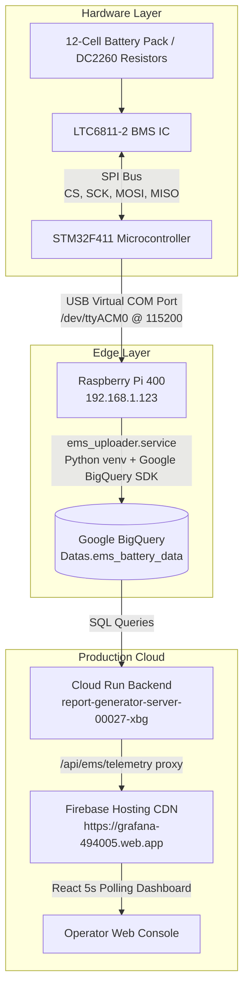

# EMS Battery Management System (BMS) — Complete Technical Guide & Reference

> **Repository**: `c:\OSSUS_BIO\STM_32_MC\EMS_FW_v1.0`  
> **Target Hardware**: STM32F411CEU6 + Analog Devices LTC6811-2  
> **Cloud Architecture**: Raspberry Pi 400 → Google BigQuery → Cloud Run → WorkMate React Console  

---

## Table of Contents
1. [End-to-End System Architecture](#1-end-to-end-system-architecture)
2. [LTC6811 SPI Communication Protocol (Master vs Slave)](#2-ltc6811-spi-communication-protocol-master-vs-slave)
3. [Voltage Decoding & Calibration Mathematics](#3-voltage-decoding--calibration-mathematics)
4. [BMS Metrics & Diagnostics Explained](#4-bms-metrics--diagnostics-explained)
5. [Raspberry Pi Telemetry Daemon & Systemd Service](#5-raspberry-pi-telemetry-daemon--systemd-service)
6. [WorkMate Dashboard & Cloud Integration](#6-workmate-dashboard--cloud-integration)

---

## 1. End-to-End System Architecture



---

## 2. LTC6811 SPI Communication Protocol (Master vs Slave)

### 2.1 The 4 Physical Hardware SPI Lines

```
STM32F411 (Master)                       LTC6811-2 (Slave)
┌────────────────┐                       ┌────────────────┐
│         CS/NSS ├──────────────────────>│ CSB (Pin 32)   │  (Active LOW Chip Select)
│           SCK  ├──────────────────────>│ SCK (Pin 31)   │  (Clock from Master)
│           MOSI ├──────────────────────>│ SDI (Pin 30)   │  (Master Out -> Slave In)
│           MISO │<──────────────────────┤ SDO (Pin 29)   │  (Slave Out -> Master In)
└────────────────┘                       └────────────────┘
```

| Line | Name | Direction | Purpose |
|---|---|---|---|
| **CS / CSB** | Chip Select | STM32 $\rightarrow$ LTC6811 | **Active LOW**. Kept HIGH at idle. Driven LOW to start transaction; raised HIGH to finish. |
| **SCK** | Serial Clock | STM32 $\rightarrow$ LTC6811 | Clock signal generated **only** by STM32 master (Mode 3: CPOL=1, CPHA=1). |
| **MOSI (SDI)** | Master Out Slave In | STM32 $\rightarrow$ LTC6811 | Sends commands, register addresses, configuration data, and PEC15 CRC to LTC6811. |
| **MISO (SDO)** | Master In Slave Out | LTC6811 $\rightarrow$ STM32 | Returns digitized cell voltages, die temperatures, supply rails, and PEC15 CRC to STM32. |

> **Golden Rule of SPI**: The Slave **never** generates clocks. The LTC6811 can only output data on MISO while the STM32 master is actively toggling the SCK line.

---

### 2.2 Phase 0: The Wakeup Pulse (`LTC6811_Wakeup`)
The LTC6811 enters **SLEEP mode** if no SPI communication occurs for 2 seconds ($t_{\text{SLEEP}}$) to save battery energy. In sleep mode, its internal oscillators and voltage references are powered down.

```c
void LTC6811_Wakeup(void)
{
    LTC6811_CS_LOW();
    delay_us(300);          // Hold CS LOW for 300 µs
    LTC6811_CS_HIGH();
    delay_us(10);           // Settle time for internal analog core
}
```
* **Electrical Behavior**: STM32 drives CS LOW for $300\ \mu\text{s}$ without generating SCK pulses. The chip senses this edge, powers on internal reference circuits, and enters STANDBY mode.

---

### 2.3 Phase 1: Start ADC Conversion (`ADCVSC`)
Before reading voltages, STM32 commands the LTC6811 internal $\Delta\Sigma$ ADCs to convert analog cell voltages into digital numbers:

```c
HAL_StatusTypeDef LTC6811_StartCellADC_SC(void)
{
    return LTC6811_SendCommand(0x03, 0x60); // 0x0360 = ADCVSC (All Cells + Sum of Cells)
}
```

1. **CS pulled LOW**.
2. **STM32 sends 4 bytes over MOSI**:
   - `Byte 0`: `0x03` (Command Byte 0)
   - `Byte 1`: `0x60` (Command Byte 1: 7 kHz Normal Mode, All 12 Cells)
   - `Byte 2`: `0xF4` (PEC15 High Byte)
   - `Byte 3`: `0x32` (PEC15 Low Byte)
3. **CS pulled HIGH**: The LTC6811 validates the PEC checksum and starts ADC conversions.
4. **STM32 waits**: `HAL_Delay(10)` allows the $2.3\text{ ms}$ conversion to complete into SRAM registers.

---

### 2.4 Phase 2: Reading Cell Voltages (`RDCVA` .. `RDCVD`)
Voltages are stored in 4 register groups (A, B, C, D), each containing 3 cells (6 data bytes + 2 PEC bytes = 8 bytes total):
* **Group A** (`RDCVA`): Cells 1, 2, 3
* **Group B** (`RDCVB`): Cells 4, 5, 6
* **Group C** (`RDCVC`): Cells 7, 8, 9
* **Group D** (`RDCVD`): Cells 10, 11, 12

```c
HAL_StatusTypeDef LTC6811_ReadRegister(uint8_t cmd0, uint8_t cmd1, uint8_t *rxBuf)
{
    LTC6811_CS_LOW();
    // 1. Send 4-byte command (2 bytes cmd + 2 bytes PEC) over MOSI
    HAL_SPI_Transmit(&hspi1, cmd, 4, timeout);

    // 2. Transmit 8 dummy bytes (0x00) over MOSI to clock in 8 response bytes from MISO
    HAL_SPI_TransmitReceive(&hspi1, dummy_tx, rxBuf, 8, timeout);
    LTC6811_CS_HIGH();
}
```

```text
CS    ──┐                                                                       ┌── (Transaction End)
        └───────────────────────────────────────────────────────────────────────┘
SCK   ────┌─┐─┌─┐─┌─┐─┌─┐...┌─┐────┌─┐─┌─┐─┌─┐─┌─┐─┌─┐─┌─┐─┌─┐─┌─┐...┌─┐────────
          |1| |2| |3| |4|   |32|   |33|                        |96|
MOSI  ────< Cmd 0 >< Cmd 1 >< PEC0 >< PEC1 >──< 0x00 Dummy bytes clocked out >───
MISO  ────────────────(High-Z)────────────────< C1_L >< C1_H >< C2_L >...< PEC >─
      |<------- Phase 1: Command ---------->|<------- Phase 2: Response ------->|
```

---

## 3. Voltage Decoding & Calibration Mathematics

### 3.1 The C Decoding Logic
```c
static void LTC6811_DecodeCellGroup(const uint8_t *rxBuf, uint8_t startIndex)
{
    uint16_t raw;
    float raw_voltage;

    // --- Cell 1 (rxBuf[0] = Low Byte, rxBuf[1] = High Byte) ---
    raw = ((uint16_t)rxBuf[1] << 8) | rxBuf[0];
    EMS_Data.RawCell[startIndex] = raw;

    raw_voltage = raw * LTC6811_CELL_LSB; // raw * 0.0001V (100 uV)

    EMS_Data.CellVoltage[startIndex] = (raw_voltage * EMS_Data.CellGain[startIndex]) 
                                     + EMS_Data.CellOffset[startIndex];
}
```

### 3.2 Why Bit Shifting (`<< 8 | rxBuf[0]`)?
* The LTC6811 measures each cell as a **16-bit integer** (`0` to `65535`).
* SPI transfers data in **8-bit bytes**. The IC sends the 16-bit number as two bytes:
  - Low Byte: `rxBuf[0]` (bits 0–7)
  - High Byte: `rxBuf[1]` (bits 8–15)
* Shifting `rxBuf[1] << 8` moves the high byte into bits 8–15 ($2^8 = 256$).
* Bitwise OR (`|`) merges the two bytes into the original 16-bit number.

### 3.3 Why Multiply by `0.0001V` (`LTC6811_CELL_LSB`)?
* Each count of the ADC represents **$100\ \mu\text{V} = 0.0001\text{ V}$**.
* $\text{Physical Volts} = \text{ADC Counts} \times 0.0001\text{ V}$.

### 3.4 Why Gain and Offset ($y = mx + c$)?
* $\text{Gain}$ ($m$, default `1.0000`): Corrects resistor divider slope errors.
* $\text{Offset}$ ($c$, default `0.0000 V`): Corrects PCB trace voltage drop and op-amp zero-offset.

### 3.5 Real-World Example (Measuring 4.0000 V)
1. **At Cell 1**: Real voltage is **$4.0000\text{ V}$**.
2. **LTC6811 ADC Counts**:
   $$\text{Counts} = \frac{4.0000\text{ V}}{0.0001\text{ V}} = \mathbf{40,000} = \text{0x9C40}$$
3. **LTC6811 Splits over SPI**:
   - `rxBuf[1]` (High Byte) = `0x9C` (156)
   - `rxBuf[0]` (Low Byte) = `0x40` (64)
4. **STM32 Reassembles**:
   - `(0x9C << 8) | 0x40` = `0x9C40` = `40,000`.
5. **Voltage Conversion**:
   - `40,000 * 0.0001f` = **`4.0000 V`**.

---

## 4. BMS Metrics & Diagnostics Explained

### 4.1 Delta V ($\Delta V$ — Cell Imbalance)
$$\Delta V = V_{\text{max\_cell}} - V_{\text{min\_cell}}$$
* **Meaning**: The voltage spread between the highest cell and lowest active cell in the pack (measured in millivolts, $\text{mV}$).
* **Why it matters**:
  - Healthy battery packs have $\Delta V < 10\text{ mV} - 20\text{ mV}$.
  - When $\Delta V > 30\text{ mV} - 50\text{ mV}$, the BMS initiates **cell balancing** (turning on discharge resistors for high cells) to prevent overcharging weak cells.
  - Helps identify aging cells before pack failure occurs.

### 4.2 LTC6811 Diagnostics & Supply Rails Panel
| Diagnostic Rail | Nominal Value | Engineering Purpose |
|---|---|---|
| **Analog Supply (VREG)** | $\sim 5.0\text{ V}$ ($4.5\text{ V} - 5.5\text{ V}$) | Powers internal analog-to-digital converter circuits. If this rail drops below $4.5\text{ V}$, voltage measurements lose accuracy. |
| **Digital Supply (VD)** | $\sim 3.0\text{ V} - 3.3\text{ V}$ | Powers internal digital logic, SPI interface, and registers. |
| **REF2 Voltage** | $\sim 3.0\text{ V}$ ($2.99\text{ V} - 3.01\text{ V}$) | Independent secondary reference voltage. Used to detect drift in primary reference (REF1). |
| **GPIO1 / Auxiliary** | $0\text{ V} - 3.0\text{ V}$ | Connected to NTC thermistor to measure cell surface temperature. |
| **Die Temperature** | $20^\circ\text{C} - 45^\circ\text{C}$ | Silicon die temperature of LTC6811. Guards against thermal runaway during heavy balancing. |
| **Status Register** | `NORMAL` | Hardware flags for Over-Voltage (OV), Under-Voltage (UV), and Open Wire (OW). |

---

## 5. Raspberry Pi Telemetry Daemon & Systemd Service

* **Location on Pi**: `/home/pi/ems_bigquery_uploader.py`
* **Virtualenv**: `/home/pi/ems_venv`
* **Systemd Service**: `/etc/systemd/system/ems_uploader.service`
* **Behavior**:
  - Automatically reads `/dev/ttyACM0` (STM32 USB CDC) at 115200 baud.
  - Automatically reconnects if USB is unplugged.
  - Pushes parsed telemetry to BigQuery table `grafana-494005.Datas.ems_battery_data` every 5 seconds.
  - Starts automatically on boot.

### Useful Management Commands on Pi:
```bash
# Check service status
sudo systemctl status ems_uploader.service

# View live streaming logs
journalctl -u ems_uploader.service -f

# Restart service
sudo systemctl restart ems_uploader.service
```

---

## 6. WorkMate Dashboard & Cloud Integration

* **Production URL**: [https://grafana-494005.web.app](https://grafana-494005.web.app)
* **Backend API**: `https://report-generator-server-983390035273.asia-south1.run.app/api/ems/telemetry`
* **BigQuery Table**: `grafana-494005.Datas.ems_battery_data`
* **GitHub Commit**: `2c201f8` on `main` branch (`Ossusbio/work-mate-report-generator`)
